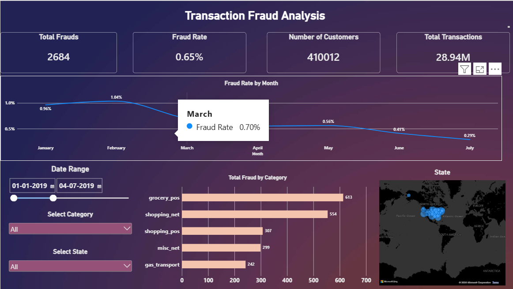
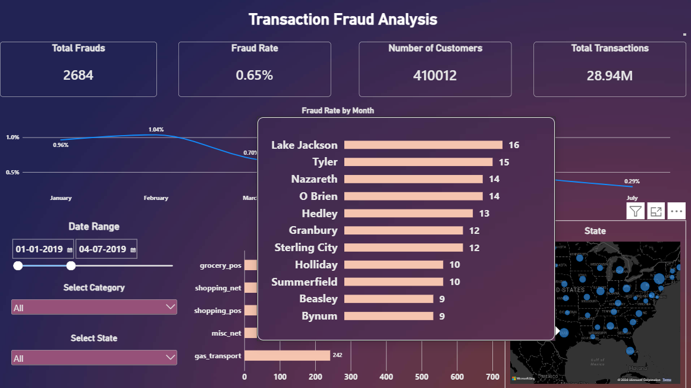

# Transaction Fraud Analysis Command Center

## Executive Summary
A major financial institution is experiencing an unacceptably high volume of credit card transaction fraud, resulting in severe financial losses and compromised customer trust. The objective of this project is to engineer an interactive, analytical command center that allows risk management teams to instantly isolate fraudulent anomalies across millions of transactions by geography, merchant category, and time-series trends to deploy targeted security interventions.

## Data Engineering & Architecture
* **Data Volume:** Processed and analyzed 1.29 million raw transaction records.
* **Data Modeling:** Engineered a highly efficient **Star Schema** to optimize Power BI's VertiPaq memory engine. 
* **Database Structure:** 
  * `fact_transactions`: Core transactional data containing foreign keys and numeric metrics (amounts, fraud flags).
  * `dim_customer`: Demographic and geographic dimensions for cardholders.
  * `dim_merchant`: Categorical data for transaction locations and industry types.
* **Time Intelligence Optimization:** Disabled hidden auto-date/time hierarchies to enforce a strict, continuous date timeline for high-performance timeline slicers without bloating the file size.

## Key DAX Metrics
Developed custom DAX measures to dynamically calculate risk across any filtered dimension:
* **Total Frauds:** `Total Frauds = CALCULATE(SUM(fact_transactions[is_fraud]))`
* **Fraud Rate:** `Fraud Rate = DIVIDE([Total Frauds], [Total Transactions], 0)`

## Advanced UI/UX & Analytical Features
* **Custom Report Page Tooltips:** Replaced default text tooltips with dynamic, embedded mini-dashboards. Hovering over a state on the primary geographic map instantly triggers a Top N filtered bar chart exposing the 10 highest-risk cities within that specific state.

* **Enterprise Interface:** Designed a high-contrast, dark-mode visual interface with strict grid alignment to minimize cognitive load for analysts.
* **Cross-Filtering Engine:** Integrated synchronized slicers (Geography, Industry Category, and Date Range) to allow instantaneous, multi-variable drill-downs.

## Actionable Business Insights
* **Targeted Anomaly Detection:** Identified a massive, highly localized fraud spike in February 2019 targeting Grocery POS systems in Texas. 
* **Risk Multiplication:** While the baseline fraud rate for the entire dataset is 0.58%, isolating the Texas Grocery POS vector revealed a localized fraud rate of **4.69%**—an 800% increase in risk, providing fraud investigators with a precise target for immediate intervention.
